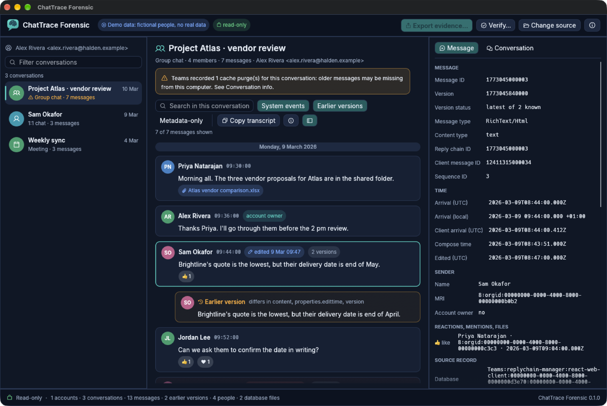
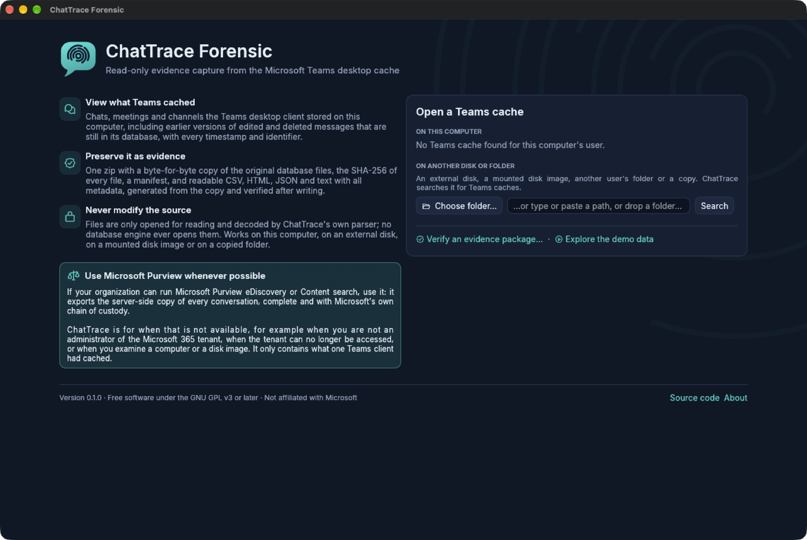
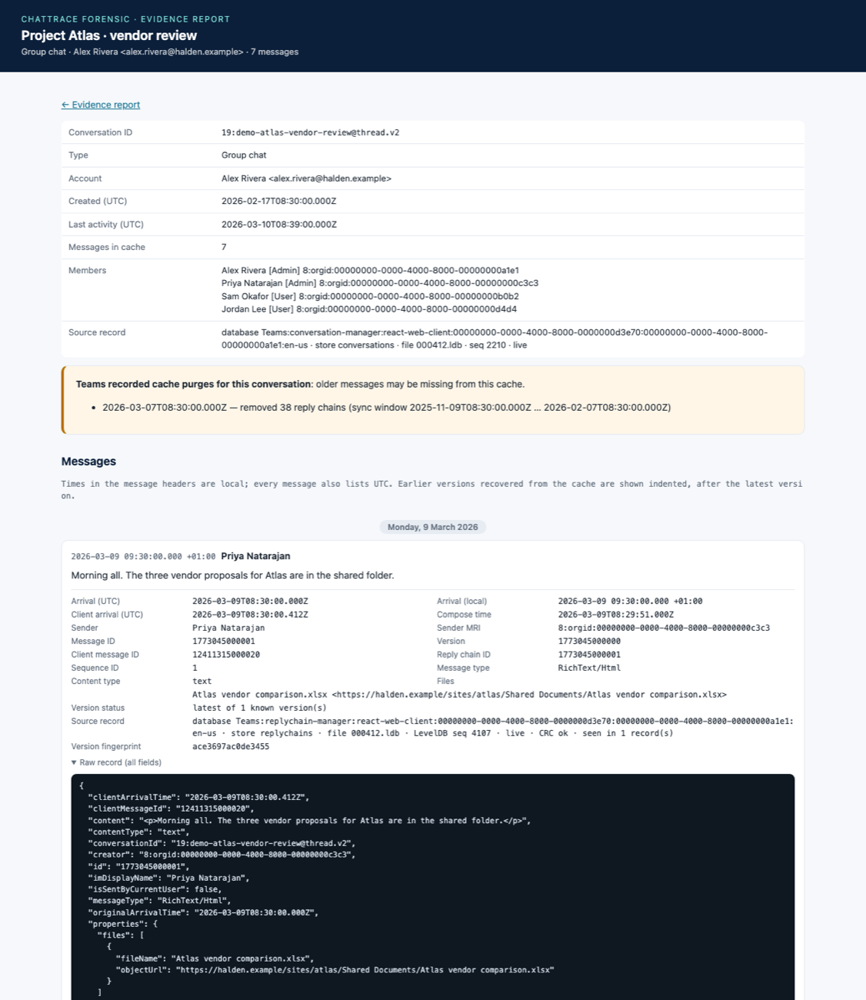

<p align="center"></p>

<h1 align="center">ChatTrace Forensic</h1>

<p align="center"><b>Read-only evidence capture from the Microsoft Teams desktop cache</b><br>
macOS · Windows · Linux · free software (GPL-3.0-or-later) · no administrator rights needed</p>

<p align="center"></p>

ChatTrace Forensic opens the local cache of the Microsoft Teams desktop client and
shows every chat, meeting and channel it holds. That includes earlier versions of
edited and deleted messages that are still in the database. It then preserves the cache as an
**evidence package**: a byte-for-byte copy of the original files, the SHA-256 of every
file, a manifest, and readable **CSV, HTML, JSON and text with all metadata visible**,
all in one zip that is verified after writing.

It never modifies the source. Files are only opened for reading and decoded by
ChatTrace's own LevelDB / IndexedDB / V8 parser; no database engine ever opens them.
It works on this computer's Teams, and also on **any folder or disk**: an external
drive, a mounted disk image of another computer, another user's profile or a copied
folder.

> [!IMPORTANT]
> **Use Microsoft Purview whenever possible.** If your organization can run
> Microsoft Purview eDiscovery or Content search, use it: it exports the server-side
> copy of every conversation, complete and with Microsoft's own chain of custody.
> ChatTrace is for when that is not available, for example when you are not an
> administrator of the Microsoft 365 tenant, when the tenant can no longer be
> accessed, or when you examine a computer or a disk image. It only contains what
> one Teams client had cached on one computer.

## Download

Get the latest version from **[Releases](https://github.com/lgibelli/chattrace/releases/latest)**:

| Platform | File | Notes |
|---|---|---|
| macOS 11+ (Apple silicon and Intel) | `ChatTrace-Forensic-<version>-macos-universal.dmg` | Signed with an Apple Developer ID and notarized. Drag to Applications. |
| Windows 10/11 x64 | `ChatTrace-Forensic-<version>-windows-x64.zip` | `chattrace.exe` (app) and `chattrace-cli.exe` (command line). Not code-signed yet: SmartScreen may ask for confirmation. |
| Linux x86_64 | `ChatTrace-Forensic-<version>-linux-x86_64.zip` | `chattrace` (app) and `chattrace-cli`. Useful for examining mounted disk images. |

Every release has a `SHA256SUMS` file and its minisign signature `SHA256SUMS.minisig`
(public key: [`assets/updater.pub`](assets/updater.pub)). The app checks for new
versions at launch and can update itself after verifying that signature. The check
can be turned off (see [Updates](docs/gui.md#updates)).

## Quick start

1. **Quit Microsoft Teams completely** (macOS: Teams › Quit; Windows: tray icon › Quit).
2. Open ChatTrace Forensic. Under *On this computer*, click **Open** next to the Teams
   cache. To use another disk or folder, click **Choose folder…** or drop the folder
   on the window.
3. Browse the conversations. Click a message to see all of its metadata and the raw record.
4. Click **Export evidence…**, fill in the case reference and examiner, and click
   **Create package**. Keep the SHA-256 shown at the end in your case notes.

From the command line:

```sh
chattrace-cli discover /Volumes/EvidenceDisk          # find Teams caches on a disk
chattrace-cli export --source /Volumes/EvidenceDisk/Users/jdoe \
    --case 2026-041 --examiner "J. Doe" -o jdoe-teams.zip
chattrace-cli verify jdoe-teams.zip                   # later: is it intact?
```

## Documentation

- **[Using the app](docs/gui.md)**: welcome screen, choosing a source, the viewer, export, verify, updates
- **[Command line](docs/cli.md)**: every command and option, with examples
- **[The evidence package](docs/evidence-package.md)**: what is in the zip, every CSV column, the manifest, how to verify and timestamp it
- **[How it works](docs/how-it-works.md)**: where Teams keeps its cache, and why read-only parsing recovers earlier versions
- [Releasing](docs/releasing.md) (maintainers) · [Changelog](CHANGELOG.md) · [Security](SECURITY.md)

<p align="center">


</p>

## What it can and cannot show

- It shows only what the Teams client cached on that computer: recent conversations and
  history that was scrolled into view. Teams also purges its cache. ChatTrace lists the purges
  Teams recorded, so gaps are documented rather than silent.
- Earlier versions of messages survive only until the database compacts them. Their absence
  does not prove a message was never edited.
- Attachments are SharePoint/OneDrive links. Their contents are not in the cache.
- Hashes prove the package has not changed since capture. They do not by themselves prove
  that the original conversation is authentic or complete.
- Supported: the new Teams client (2023+) for work/school and personal accounts. Classic
  Teams caches are found and preserved byte for byte, but their chats are not decoded.

## Build from source

Requires Rust 1.95+.

```sh
cargo build --release      # target/release/chattrace (app) and chattrace-cli
cargo test
```

Linux also needs `pkg-config libxkbcommon-dev libwayland-dev libxcb-render0-dev libxcb-shape0-dev libxcb-xfixes0-dev`.
The release builds come from [GitHub Actions](.github/workflows/release.yml).

## License and credits

ChatTrace Forensic is © 2026 **Luca Gibelli · [Salamacchine](https://salamacchine.it)**, free
software under the [GNU General Public License v3.0 or later](LICENSE). Third-party components
and their licenses are listed in [THIRD_PARTY_NOTICES.md](THIRD_PARTY_NOTICES.md).

ChatTrace Forensic is an independent project and is not affiliated with, endorsed by or
sponsored by Microsoft. Microsoft Teams and Microsoft Purview are trademarks of Microsoft
Corporation.
