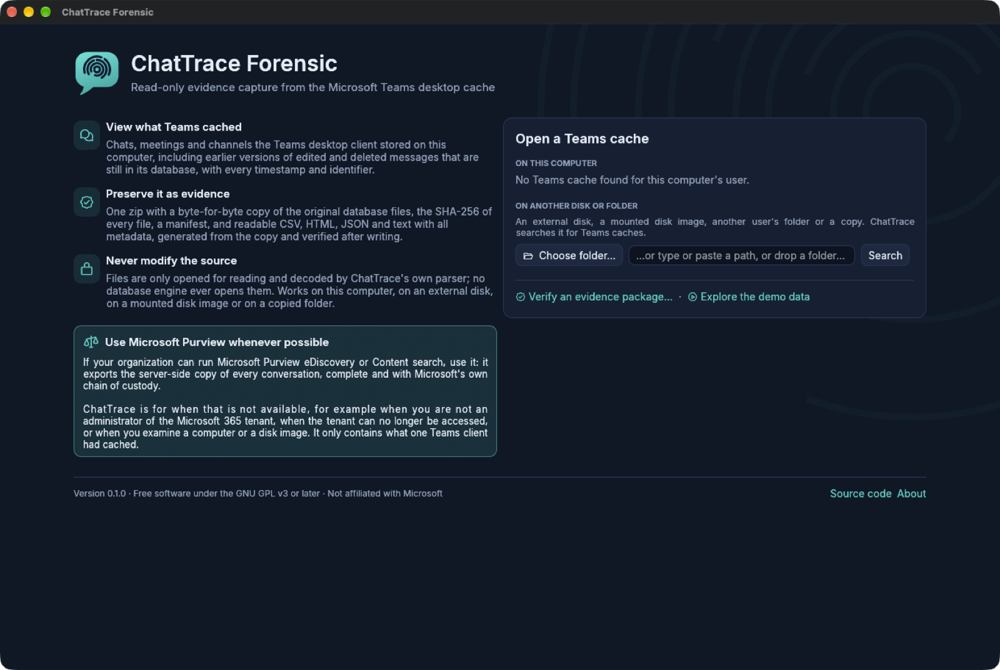
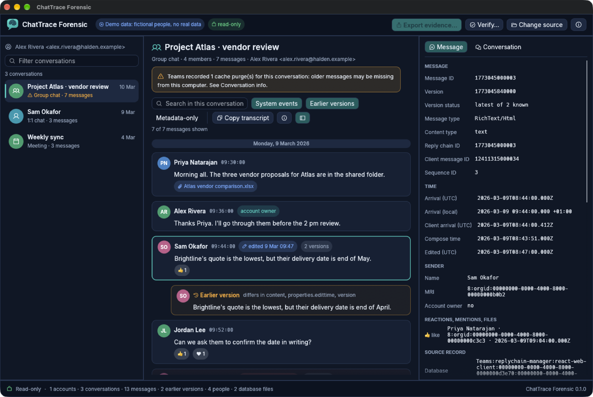

# Using the ChatTrace Forensic app

The app has three parts: the **welcome screen**, where you choose what to open; the
**viewer**; and the **dialogs** for exporting and verifying evidence. Nothing you do in
the app writes to the Teams cache you open.

> Before you capture this computer's own Teams, **quit Microsoft Teams completely**
> (macOS: *Teams › Quit*; Windows: right-click the tray icon › *Quit*). Teams keeps writing
> to its cache while it runs, so files could change while they are copied. ChatTrace warns
> you when Teams is running, and records that fact in the package.

## Welcome screen

The left column explains what the app does. It also says when to use Microsoft Purview
instead: whenever your organization can run Purview eDiscovery or Content search, that
export is the authoritative record.

The **Open a Teams cache** card on the right lists the sources:

- **On this computer**: the Teams caches of the user running ChatTrace, found
  automatically. The row shows the account type (work/school or personal), size, file
  count and last change. Click **Open**.
- **On another disk or folder**: click **Choose folder…**, type or paste a path and press
  **Search**, or simply drop a folder on the window. The folder can be:
  - an external disk or a mounted disk image (ChatTrace looks in `Users/*` and `home/*` for
    the macOS and Windows Teams locations);
  - a user's home folder, or any folder that contains a copy of a Teams profile;
  - the `…indexeddb.leveldb` folder itself.

  If the exact locations are not there, ChatTrace searches the folder tree (skipping
  system folders) and lists every Teams cache it finds. Each result shows the layout it
  came from (macOS or Windows) and the user folder name. When a dropped folder contains
  exactly one cache, it opens directly.
- **Verify an evidence package…** checks a zip made earlier (see [Verify](#verify)).
- **Explore the demo data** opens a fictional dataset, useful for training and to try the
  app without real data.

On macOS the system may ask for permission the first time ChatTrace reads another
app's data or an external disk. Allow it. If access is still refused, give ChatTrace Forensic
*Full Disk Access* in *System Settings › Privacy & Security*.

## The viewer

**Top bar.** The source (with its full path when you hover it), the *read-only* badge, and
the actions: **Export evidence…**, **Verify…**, **Change source**, **Reload** (read the cache
again, for example after quitting Teams) and **About**. When a new version is available, an
**Update to x.y.z** button appears here.

**Conversation list (left).** Every conversation in the cache, newest first: group chats, 1:1
chats, meetings and channels. With several accounts in one cache (for example a work and a
school account), pick one from the account menu at the top, or *All accounts*. The filter box
matches titles, member names and conversation IDs. A ⚠ marks conversations for which Teams
recorded a cache purge, meaning older messages may be missing from this computer.

**Messages (centre).** Messages are grouped by day, with local times (hover a time to see it in UTC).

| Marker | Meaning |
|---|---|
| *account owner* | sent by the account whose cache this is |
| *edited …* | Teams recorded an edit, at that time |
| *deleted …* | the message was deleted; the text shown is the deletion placeholder |
| *n versions* | more than one version of the message is in the cache |
| *Earlier version · differs in …* (amber, indented) | an older state of the message recovered from the database, listed after the current one, with the fields that differ |
| *CRC failed* | the database block holding this record failed its checksum |
| 👍 2, 📎 file | reactions (hover for who) and attached files (hover for the link) |

The toolbar above the messages:

- **Search in this conversation**: matches text, sender and message ID.
- **System events**: show or hide calls, meeting start/end, members added, and similar events.
- **Earlier versions**: show or hide older versions recovered from the database.
  **Metadata-only** also shows older versions that differ only in internal fields.
- **Copy transcript**: copies a plain-text transcript of the conversation.
- ⓘ shows the conversation details. The sidebar button shows or hides the details panel.

**Details panel (right).** Click a message to see all of its metadata. That covers the IDs
(message, version, client message, reply chain, sequence), every timestamp in UTC and local
time, sender name and MRI, edit and delete times, who deleted it, and reactions with who and
when. It also shows mentions, files, and the **source record**: database, object store,
LevelDB file, sequence number, record status (*live*, *superseded* or *deleted*), CRC result
and version fingerprint. Below that is the **raw record** as JSON, with a *Copy JSON* button.
The *Conversation* tab shows members and roles, recorded cache purges, the source record and
the raw conversation record.

**Status bar.** Counts of accounts, conversations, messages, earlier versions, people and
database files, plus any CRC or decode errors, and how long parsing took.

## Export evidence

Click **Export evidence…** in the top bar.

- **Case / reference**, **Examiner**, **Notes**: recorded in the manifest and shown on the
  first page of the HTML report.
- **Save to**: the zip to create. An existing file is never overwritten. The zip cannot be
  saved inside the folder being captured. When you capture an external disk, save to a
  different disk if you can (the package records it if you don't).
- **Also decode every other IndexedDB store**: adds `all_records.jsonl` with every record of
  every store, in every version. Leave it on unless size matters.
- **Keep an unzipped copy next to the zip**: also leaves the extracted package folder, so you
  can open the HTML report right away.

A progress bar follows the steps: copy and hash, parse the copy, write CSV/HTML/JSON, write the
zip, verify the zip. At the end you see the zip's path, its **SHA-256** (with a copy button),
the number of files and messages, any warnings, and buttons to show the zip in Finder or
Explorer and to open the HTML report.

Write the SHA-256 down somewhere separate from the zip, such as case notes or an e-mail. It
lets anyone show later that the package has not changed. See
[The evidence package](evidence-package.md) for what is inside, and how to add a trusted
timestamp.

## Verify

**Verify…** (top bar, or on the welcome screen; dropping a `.zip` on the window opens it too)
asks for an evidence zip. It recomputes its SHA-256 and compares it with the `.sha256` file
next to it. It then recomputes the SHA-256 of every file inside and compares them with
`SHA256SUMS`. The result is either *Intact*, or a list of modified, missing or unlisted files.

## Updates

At launch ChatTrace makes one request to `api.github.com` to ask for the latest release. It
sends nothing about you or your cases. When a newer version exists, an **Update to x.y.z**
button appears. The update dialog shows the release notes and offers:

- **Update now**: downloads the update and installs it, but only if the checksum file carries
  a valid signature from the ChatTrace release key embedded in the app and the download matches
  that checksum. On macOS the new app must also pass Apple's code-signature check and come from
  the same developer. The app then asks you to restart. Evidence on disk is not affected.
- **Release page**, **Skip this version**, **Later**.

To turn the check off, untick *Check for updates when ChatTrace starts* in **About**. You can
also start the app with `--no-update-check` or with the environment variable
`CHATTRACE_NO_UPDATE_CHECK=1`. *Check now* in About checks on demand.

## Crash reports

If ChatTrace crashes, it saves a crash report on your computer, and **sends nothing**. At the
next launch it shows the report and asks:

- **Send report**: sends it over HTTPS to the developer's Sentry account (hosted in the EU, set
  to store neither IP addresses nor locations), to help fix the bug.
- **Don't send**: deletes it.
- **Never ask**: deletes it and stops saving crash reports (turn it back on in **About**).

The dialog shows the exact text that would be sent: the ChatTrace version, the operating system
and its version, the processor type, where in ChatTrace's code the crash happened (function
names), and the error message with any quoted text, file paths, e-mail addresses and IDs
removed. It contains no chat content, nothing about your cases or evidence, and no computer or
user name. Reports are kept in ChatTrace's settings folder, readable only by you, and at most
three are kept.

Only the official releases can send reports; copies built from source never do. To turn
reports off entirely, untick the option in **About**, or set `CHATTRACE_NO_CRASH_REPORTS=1`.

## About

**About** shows the version, author, license, links to the source code and third-party
notices, and the update and crash-report settings.

## Keyboard and mouse

- Drop a folder on the window to search it. Drop a `.zip` to verify it.
- `Esc` closes dialogs.
- All values in the details panel and all message text can be selected and copied.
